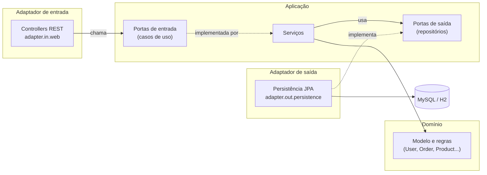
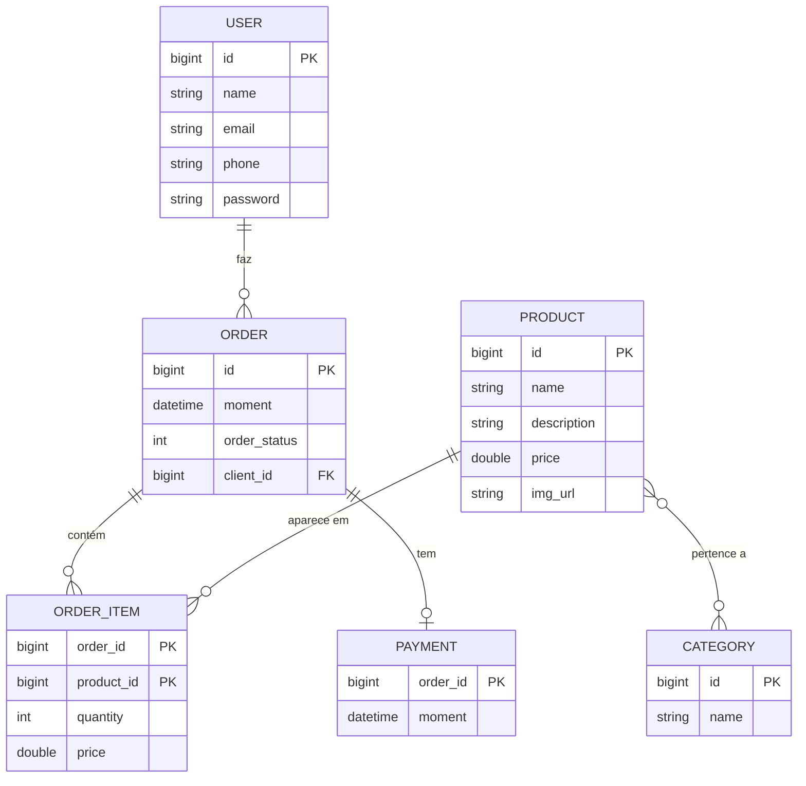

# API de Pedidos

API REST de um e-commerce simplificado (usuários, pedidos, itens, produtos, categorias e pagamentos), feita com Java, Spring Boot e JPA/Hibernate, organizada em **arquitetura hexagonal** (portas e adaptadores).

> **Projeto de estudo.** Este repositório é uma **versão adaptada** do projeto do curso "Java COMPLETO" (Udemy). Veja o que foi mantido e o que foi alterado em [Origem e créditos](#origem-e-créditos).

## Índice
- [O que o projeto faz](#o-que-o-projeto-faz)
- [Stack](#stack)
- [Arquitetura](#arquitetura)
- [Modelo de dados](#modelo-de-dados)
- [Como rodar](#como-rodar)
- [Documentação da API (Swagger)](#documentação-da-api-swagger)
- [Endpoints](#endpoints)
- [Formato dos erros](#formato-dos-erros)
- [Banco de dados e migrações](#banco-de-dados-e-migrações)
- [Testes](#testes)
- [Decisões técnicas](#decisões-técnicas)
- [Limitações conhecidas](#limitações-conhecidas)
- [Possíveis evoluções](#possíveis-evoluções)
- [Origem e créditos](#origem-e-créditos)

## O que o projeto faz
- **Usuários:** cadastro, consulta, atualização e remoção, com validação da entrada. A senha nunca é devolvida pela API.
- **Pedidos:** consulta com o cliente, o status, a data (ISO 8601, UTC), os itens, o pagamento (quando houver) e o total, calculado no domínio.
- **Produtos e categorias:** consulta, com a associação muitos-para-muitos entre elas.
- **Erros padronizados:** respostas 400, 404 e 409 em um formato único.
- **Banco real com migrações:** MySQL em Docker, com esquema e dados de exemplo criados pelo Flyway.

**Status:** primeira versão concluída (outubro de 2026): arquitetura hexagonal, MySQL com Flyway, testes por camada, testes de arquitetura e documentação Swagger. O que ficou de fora de propósito está em [Possíveis evoluções](#possíveis-evoluções).

## Stack
- Java 21
- Spring Boot 4.0.8 (Web MVC, Data JPA, Validation)
- Maven (com o Maven Wrapper)
- MySQL 8 em Docker (padrão) e Flyway para as migrações
- H2 em memória (perfil `test`, usado nos testes e para rodar sem Docker)
- springdoc-openapi 3.0.3 (Swagger UI)
- JUnit 5, Mockito e ArchUnit (testes de arquitetura)

## Arquitetura
O projeto segue a **arquitetura hexagonal**: o domínio fica no centro, sem depender de nenhum framework, e tudo o que é externo (HTTP e banco de dados) entra e sai por **portas**, implementadas por **adaptadores**.



Estrutura de pacotes em `com.modestoneto.pedidos`:

```
domain                      núcleo: modelo, regras e exceções; sem Spring, JPA ou Jackson
 ├─ model                   User, Order, OrderItem, Product, Category, Payment
 ├─ model.enums             OrderStatus
 └─ exception               ResourceNotFoundException, ConflictException
application
 ├─ port.in                 casos de uso (interfaces)
 ├─ port.out                repositórios (interfaces)
 └─ service                 implementam os casos de uso e usam as portas de saída
adapter
 ├─ in.web                  controllers REST e DTOs
 ├─ in.web.exception        tratamento global de erros (@ControllerAdvice)
 └─ out.persistence         entidades JPA, repositórios Spring Data, mappers e adaptadores
config                      configuração de beans, OpenAPI e dados de exemplo do perfil test
```

**Regra de dependência:** o domínio não depende de nada; a aplicação depende só do domínio; os adaptadores dependem da aplicação e do domínio, nunca o contrário. Por isso o modelo de domínio não tem anotações de JPA nem de Jackson: os mapeamentos de banco ficam em classes `*JpaEntity`, e o formato do JSON fica nos DTOs.

Fluxo de uma requisição:
```
HTTP → Controller → caso de uso (porta de entrada) → serviço → porta de saída → adaptador de persistência → banco
```

## Modelo de dados


- **Tabelas:** `tb_user`, `tb_order`, `tb_order_item`, `tb_product`, `tb_category`, `tb_payment` e a tabela de junção `tb_product_category`.
- **Itens do pedido:** a chave primária é composta (`order_id`, `product_id`). O `price` é o valor no momento da compra, separado do preço atual do produto.
- **Pagamento:** relação 1:1 com o pedido; o `id` do pagamento é o `id` do pedido (`@MapsId`).
- **Status do pedido:** gravado como número (1 a 5) e convertido para o enum `OrderStatus` (`WAITING_PAYMENT`, `PAID`, `SHIPPED`, `DELIVERED`, `CANCELED`).
- **Regras no domínio:** `OrderItem.getSubTotal()` é `price × quantity`, e `Order.getTotal()` é a soma dos subtotais.

## Como rodar
Pré-requisitos: JDK 21 ou superior, Docker (com Docker Compose) e Maven (o projeto inclui o Maven Wrapper).

1. Crie o arquivo `.env` na raiz a partir do modelo `.env.example` e troque os valores por senhas suas. O `.env` **não** é versionado.
2. Suba o banco: `docker compose up -d --wait`.
3. Suba a aplicação:

```
.\mvnw.cmd spring-boot:run
```

Por padrão a aplicação usa o **MySQL do Docker** (porta `3307`). Na primeira subida, o Flyway cria as tabelas e carrega os dados de exemplo. O Spring lê o `.env` sozinho, então não é preciso exportar variáveis. A aplicação sobe em `http://localhost:8080`.

Para rodar **sem Docker**, use o perfil `test`, que troca o banco por um H2 em memória, com os mesmos dados de exemplo (carregados por código):

```
.\mvnw.cmd spring-boot:run "-Dspring-boot.run.profiles=test"
```

Nesse perfil, o console do H2 fica em `/h2-console` (URL `jdbc:h2:mem:testdb`, usuário `sa`, senha vazia).

## Documentação da API (Swagger)
Com a aplicação no ar:

- **Swagger UI:** http://localhost:8080/swagger-ui.html
- **Especificação OpenAPI (JSON):** http://localhost:8080/v3/api-docs

Pelo Swagger UI dá para chamar todos os endpoints ("Try it out") e ver os formatos de resposta, inclusive os de erro.

## Endpoints
| Método | Rota | Descrição | Respostas |
|---|---|---|---|
| GET | `/users` | Lista os usuários | 200 |
| GET | `/users/{id}` | Busca um usuário | 200, 400, 404 |
| POST | `/users` | Cria um usuário (header `Location`) | 201, 400 |
| PUT | `/users/{id}` | Atualiza `name`, `email` e `phone` (a senha não muda) | 200, 400, 404 |
| DELETE | `/users/{id}` | Remove um usuário | 204, 404, 409 (tem pedidos) |
| GET | `/orders` | Lista os pedidos, com cliente, itens, pagamento e total | 200 |
| GET | `/orders/{id}` | Busca um pedido (pagamento `null` se não pago) | 200, 400, 404 |
| GET | `/products` | Lista os produtos, com suas categorias | 200 |
| GET | `/products/{id}` | Busca um produto | 200, 400, 404 |
| GET | `/categories` | Lista as categorias | 200 |
| GET | `/categories/{id}` | Busca uma categoria | 200, 400, 404 |

Exemplo de criação de usuário:

```
POST /users
Content-Type: application/json

{ "name": "Carla Exemplo", "email": "carla@exemplo.com", "phone": "(00) 00000-0004", "password": "uma-senha" }
```

Resposta: `201 Created`, com `Location: http://localhost:8080/users/4` e o usuário no corpo (sem a senha).

## Formato dos erros
Todos os erros tratados voltam no mesmo formato:

```json
{
  "timestamp": "2026-10-20T18:56:52Z",
  "status": 404,
  "error": "Recurso não encontrado",
  "message": "Usuário não encontrado: id 999",
  "path": "/users/999"
}
```

| Status | Quando acontece |
|---|---|
| 400 | Dados de entrada inválidos, corpo da requisição ilegível ou id com tipo errado (por exemplo `/users/abc`) |
| 404 | O id pedido não existe |
| 409 | Remover um usuário que tem pedidos |

As exceções (`ResourceNotFoundException` e `ConflictException`) ficam no domínio e não conhecem HTTP. Um `@ControllerAdvice` no adaptador web as traduz para os códigos acima, e o adaptador de persistência converte a violação de integridade do banco em `ConflictException`.

## Banco de dados e migrações
- **Contêiner:** o `docker-compose.yml` na raiz sobe um MySQL 8 local, publicado só em `127.0.0.1:3307`. Comandos do dia a dia: `docker compose up -d --wait`, `docker compose ps`, `docker compose down` (mantém os dados) e `docker compose down -v` (apaga os dados).
- **Credenciais:** ficam no `.env` (`DB_NAME`, `DB_USER`, `DB_PASSWORD` e `DB_ROOT_PASSWORD`). Nenhuma senha está no repositório. Se você mudar a senha no `.env` depois que o banco foi criado, é preciso recriar o volume com `docker compose down -v`.
- **Migrações (Flyway):** o esquema e os dados de exemplo vêm de `src/main/resources/db/migration` (`V1__schema.sql` e `V2__seed.sql`), e o Hibernate roda com `ddl-auto=validate`, só conferindo se as entidades combinam com as tabelas. **Migração já aplicada não deve ser editada** (o Flyway guarda um checksum); para mudar o esquema, crie uma nova (`V3__...`). Em desenvolvimento, `docker compose down -v` recomeça do zero.
- **Dois bancos, dois perfis:** o padrão usa MySQL com Flyway; o perfil `test` usa H2 em memória, com `ddl-auto=create-drop` e os dados carregados por código (`TestConfig`).
- **Datas:** o Hibernate grava e lê em UTC (`hibernate.jdbc.time_zone=UTC`), e a API devolve ISO 8601 (`2026-06-20T19:53:07Z`).
- **Só um adaptador muda:** trocar de H2 para MySQL alterou apenas a configuração e o adaptador de persistência. O domínio e a camada de aplicação não foram tocados, que é o ponto da arquitetura hexagonal.

## Testes
Os testes **não precisam de Docker**: usam o perfil `test` (H2) ou simulam as dependências.

```
.\mvnw.cmd test
```

Para rodar uma classe ou um método:

```
.\mvnw.cmd test "-Dtest=UserServiceTest"
.\mvnw.cmd test "-Dtest=UserServiceTest#updateAlteraNomeEmailETelefoneMasNaoASenha"
```

| Camada | Tipo de teste | O que verifica |
|---|---|---|
| Domínio | JUnit puro, sem Spring | Conversão de `OrderStatus`, subtotal do item e total do pedido |
| Casos de uso (serviços) | Mockito, sem Spring | Regras de negócio e as exceções de "id não encontrado", com as portas de saída simuladas |
| Adaptadores de persistência | `@DataJpaTest` (H2) | Gravação e leitura reais: chave composta dos itens, `@MapsId` do pagamento, associação muitos-para-muitos |
| Conflito na remoção | `@SpringBootTest` | A violação de chave estrangeira vira `ConflictException`. Fica fora do `@DataJpaTest` porque o erro só aparece no commit |
| Controllers | `@WebMvcTest` (casos de uso simulados) | Status HTTP, corpo, header `Location`, validação e o formato dos erros |
| Arquitetura | ArchUnit | A regra de dependência da hexagonal (veja abaixo) |

Nos testes de persistência, cada teste roda numa transação desfeita no final, e `flush` e `clear` forçam a ida ao banco antes da leitura, para o teste não ler apenas da memória.

**Testes de arquitetura (`ArchitectureTest`).** Verificam, no código de produção, que:
- o domínio não depende de `application`, `adapter` nem `config`, e não importa Spring, JPA, Jackson, Swagger nem Hibernate;
- a aplicação não depende dos adaptadores, nem de JPA, Spring Data, Jackson ou Swagger (o `@Service` do Spring é permitido);
- o adaptador web e o de persistência não dependem um do outro;
- os controllers usam só as portas de entrada, sem chamar serviços nem portas de saída diretamente.

Assim, a regra de dependência deixa de ser só uma convenção: se alguém importar Spring no domínio, por exemplo, o `mvnw test` falha.

## Decisões técnicas
- **Hexagonal com domínio puro.** As entidades JPA são classes separadas do modelo de domínio, com mappers entre elas. O custo é ter duas classes por conceito; o ganho é um núcleo que não depende de framework e que se testa sem Spring.
- **DTOs em vez de expor as entidades.** O domínio nunca é serializado direto. Isso evita referências circulares no JSON, esconde a senha e deixa o formato de data (`@JsonFormat`) no adaptador web.
- **Exceções de domínio.** O "não achou" é uma exceção (`ResourceNotFoundException`), e não um `Optional` ou `null` que o controller precisa tratar. As portas de saída continuam devolvendo `Optional`, porque ali "não achar" é um resultado normal.
- **Itens e pagamento gravados pelo adaptador.** O pedido precisa existir (com `id`) antes dos seus itens e do pagamento, então o adaptador de persistência grava nessa ordem, dentro de uma transação.
- **Status do pedido como número.** Renomear uma constante do enum não quebra os dados já gravados.
- **MySQL como padrão, H2 só em teste.** Rodar sem perfil usa o banco real. O H2 não é idêntico ao MySQL, por isso o esquema real vem do Flyway e o Hibernate apenas valida.
- **Credenciais fora do código.** O `.env` não é versionado, e o `.env.example` traz só valores falsos.
- **Preço do item separado do preço do produto.** O pedido guarda o valor do momento da compra.

## Limitações conhecidas
- **Valores monetários** usam `Double`, como no curso de referência. Isso é aceitável para estudo, mas em um sistema real o correto é `BigDecimal`, por causa de arredondamento.
- **Senhas** são gravadas em texto puro. O projeto não usa Spring Security nem criptografia, e a senha nunca é devolvida pela API. Em um sistema real seria obrigatório gravar apenas um hash.
- **Sem autenticação nem autorização:** todos os endpoints são abertos.
- **Só leitura para pedidos, produtos e categorias:** a API cria, atualiza e remove apenas usuários.
- **Erros inesperados** (por exemplo, uma falha de banco que não seja de integridade) ainda caem no tratamento padrão do Spring, com resposta 500, e não no formato próprio descrito acima.

## Possíveis evoluções
Itens que ficaram fora desta versão, em ordem aproximada de importância:
- **Segurança:** gravar a senha com hash (por exemplo BCrypt) e proteger os endpoints com autenticação (Spring Security, com OAuth2 e JWT).
- **`BigDecimal`** no lugar de `Double` para os valores monetários.
- **Escrita em pedidos, produtos e categorias:** hoje só há consulta; faltam criar, atualizar e remover (e, para pedidos, o fluxo de mudança de status e de pagamento).
- **E-mail único:** uma restrição `UNIQUE` no esquema (com uma nova migração) e a resposta 409 correspondente.
- **Paginação** nas listagens.
- **Testcontainers** com MySQL real nos testes de persistência, no lugar do H2, para eliminar a diferença entre os dois bancos.
- **Integração contínua:** um pipeline (por exemplo GitHub Actions) rodando `mvnw test` a cada push.

## Origem e créditos
Este projeto é de estudo e é baseado no curso **"Java COMPLETO"** (Udemy), cujo projeto de referência é uma API de pedidos com Spring Boot e JPA.

Esta é uma **versão adaptada**, não uma cópia do projeto do curso. Principais diferenças:
- **Arquitetura hexagonal** (portas e adaptadores), no lugar da arquitetura em camadas do curso.
- **Domínio separado da persistência:** o modelo de domínio não tem anotações de JPA; os mapeamentos ficam em classes próprias do adaptador de persistência.
- **DTOs** nas respostas e entradas da API, em vez de expor as entidades.
- **Exceções de domínio e tratamento global de erros** em um formato único.
- **Spring Boot 4.x**, enquanto o curso foi gravado com Spring Boot 3.
- **MySQL em Docker e migrações com Flyway**, com o H2 restrito ao perfil de teste.
- **Testes por camada**, **testes de arquitetura (ArchUnit)** e **documentação OpenAPI (Swagger UI)**.

O domínio (usuários, pedidos, itens, produtos, categorias e pagamentos) e os casos de uso seguem o do curso.
